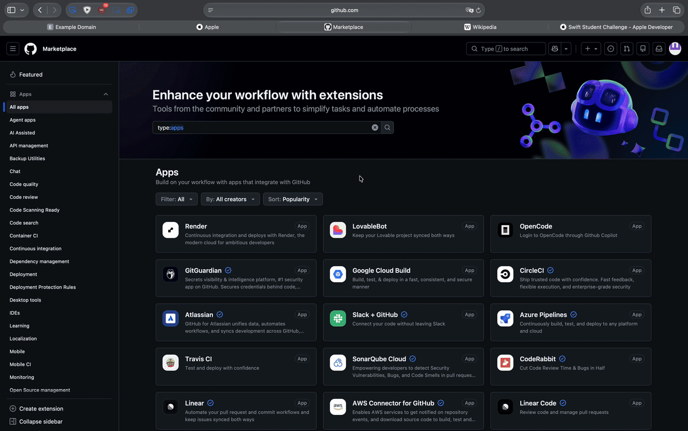

<p align="center">
  
</p>

<h1 align="center">Last Tab for Safari</h1>

<p align="center">
  A <b>⌘ Tab</b>-style tab switcher for Safari on macOS.<br>
  Tabs in most-recently-used order, with page previews, everywhere in Safari.
</p>

<p align="center">
  <a href="https://github.com/bi472/last-tab-safari/releases/latest"></a>
  <a href="https://github.com/bi472/last-tab-safari/actions/workflows/ci.yml"></a>
  
  
  <a href="LICENSE"></a>
</p>

<p align="center">
  <a href="#install"><b>Install</b></a> ·
  <a href="#how-it-works">How it works</a> ·
  <a href="#features">Features</a> ·
  <a href="#good-to-know">Good to know</a> ·
  <a href="CONTRIBUTING.md">Contributing</a>
</p>

<p align="center">
  
</p>

---

## How it works

Hold **⌥ Option** and press **Q**: a horizontal strip of the current window's tabs appears in
most-recently-used order, with page previews.

| Action | Keys |
| --- | --- |
| Open the strip / step right | **⌥ Q** (keep holding ⌥, press **Q** again) |
| Step left | **⌥ ⇧ Q** or **←** |
| Step right | **→** |
| Switch to the selected tab | release **⌥ Option** |
| Cancel | **Esc** |
| Jump back to the previous tab | a quick **⌥ Q** tap |

It works everywhere in Safari: on websites, the Start Page, Safari's own pages and in the address bar.

## Features

- **MRU order per window.** Each window keeps its own history; private windows are left out.
- **Page previews.** Visited tabs show a snapshot; others show their favicon or first letter.
- **Any shortcut.** Record any combination with ⌘ Command, ⌥ Option or ⌃ Control in one click.
  **Back** follows Forward + ⇧ Shift until you give it a shortcut of its own.
- **Conflict warnings.** The popup tells you when a shortcut overrides a Safari one, and when the
  Last Tab app isn't running.
- **Private by design.** Previews stay on this Mac in the app's cache and are erased when their tabs
  close or Safari quits. Nothing is sent anywhere.

## Install

Paste this into Terminal:

```bash
curl -fsSL https://raw.githubusercontent.com/bi472/last-tab-safari/main/scripts/install.sh | bash
```

It downloads the latest release into `/Applications`, clears the download quarantine and opens
Last Tab. The same command updates an existing install.

A setup window then walks you through the rest and ticks each step off as you do it:

1. **Turn on the extension** in Safari → Settings → Extensions.
2. **Allow it on every website** (Edit Websites… → For other websites: **Allow**) for page previews.
3. **Open at login**, so the shortcut keeps working after a restart.

Then hold **⌥ Option** in Safari and press **Q**. The setup window is always one click away:
menu bar icon → **Setup Instructions…**

<details>
<summary>Install by hand</summary>

1. Download `LastTab-<version>.zip` from [Releases](../../releases/latest) and double-click it.
2. Drag **Last Tab.app** into **Applications**.
3. The app isn't notarized, so macOS blocks the first launch. Run once:

   ```bash
   xattr -dr com.apple.quarantine "/Applications/Last Tab.app"
   ```

   (Or open it, then System Settings → Privacy & Security → **Open Anyway**.)
4. Open **Last Tab** and follow the setup window.

</details>

If Safari doesn't list the extension, turn on Safari → Settings → Advanced → *Show features for web
developers*, then Develop → **Allow Unsigned Extensions**.

## How the pieces fit

Last Tab is two parts that work together:

1. **The menu bar app** catches the shortcut while Safari is active and draws the strip.
2. **The Safari extension** tracks tab order and previews.

To change the shortcut, click the Last Tab button on Safari's toolbar (or Safari → Settings →
Extensions → Last Tab → Settings), click **Forward** and press the new combination.

## Good to know

- While Safari is active the shortcut belongs to Last Tab. If it was a Safari shortcut too, Safari's
  version stops working, and an ⌥ shortcut no longer types its character (⌥ Q: «œ»).
- **⌃ Tab** can't be used: Safari keeps it for itself.
- Safari → Settings → Extensions → Last Tab shows a red error: *Invalid `persistent` manifest entry*.
  You can ignore it: the manifest asks Safari to keep the extension's background script running so
  the shortcut responds on the first press, and Safari only complains about the format of that request.
- The **Shortcuts** field on the same page is Safari's own: it opens the Last Tab toolbar popup.
  It is not the switcher shortcut, which you change in the popup itself.

## Contributing

Bug reports and pull requests are welcome. [CONTRIBUTING.md](CONTRIBUTING.md) explains how to build
from source, run the tests and cut a release; [CHANGELOG.md](CHANGELOG.md) lists what changed in
each version.

## License

[MIT](LICENSE) © 2026 Aidar Idrisov
